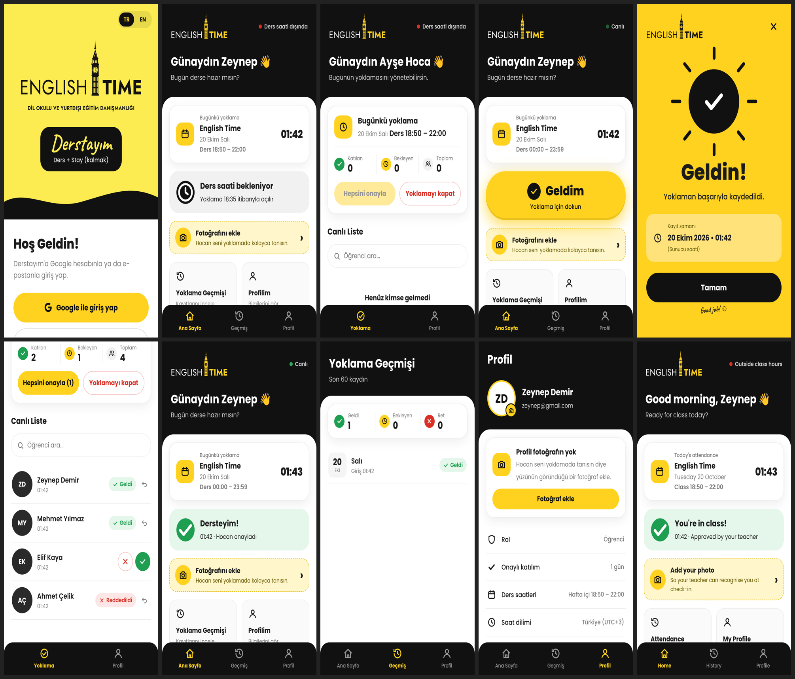

# 🟡 Derstayım

**Ders + Stay (kalmak).**

İngilizcede *stay*, “kalmak” veya “bulunmak” anlamına gelir. Derstayım, Türkçedeki “Dersteyim” ifadesinden ilham alan bir kelime oyunudur.

## 📚 Proje Hakkında

Kurslarda yoklamanın unutulması veya sonradan doldurulması, öğrencilerin derse gerçekten katılıp katılmadığını belirsiz hâle getirebilir.

**Derstayım**, bu sorunu basit bir dijital yoklama sistemiyle çözmeyi hedefler. Öğrenciler kendi telefonlarından yoklama verir, öğretmen ise katılım kayıtlarını canlı olarak görüntüler ve tek dokunuşla onaylar veya reddeder.

Daha az uğraş, daha güvenilir yoklama. 🎯

## ✨ Temel Özellikler

- 📱 Tek dokunuşla yoklama, sadece ders saatinde (hafta içi 18:50–22:00; 15 dk önce açılır)
- 🔐 Google veya e-posta/şifre ile giriş (e-posta hesabı doğrulanmadan yoklama verilemez)
- 🕒 Sunucu saatine göre kayıt
- ✅ Öğretmen onayı ve canlı liste
- 🔒 Yetkiye dayalı güvenli kayıt sistemi

## 📸 Ekranlar



## ⚙️ Nasıl Çalışır

1. Öğrenci Google ya da e-posta ile girer.
2. Ders saatinde (hafta içi 18:35'ten 22:00'ye kadar) **Geldim**'e basar; giriş saati sunucu saatiyle kaydedilir.
3. Hoca kendi telefonunda listeyi canlı görür: **Onayla / Reddet** ya da **Hepsini onayla**. Hocanın ayarlaması gereken bir şey yok.
4. Hoca **Yoklamayı kapat** deyince o gün kimse giriş yapamaz.
5. Öğrenci **Geçmiş** sekmesinde eski kayıtlarını, **Profil**'de bilgilerini görür.
6. Uygulama **Türkçe** ve **İngilizce**: giriş ekranındaki ve Profil'deki **TR | EN** düğmesiyle değişir, seçim telefonda hatırlanır.
7. Öğrenci Profil'den **fotoğrafını** ekler; hoca listede görür, dokununca büyütür. Fotoğrafı sadece sahibi ve hocalar görebilir.
8. Uygulama her açıldığında **Günün Kelimesi** çıkar: anlamı, örnek cümle ve 🔊 İngiliz aksanıyla telaffuz. Kelime listesi `public/words.js`'te (100+ kelime).

Teknoloji: düz HTML/CSS/JS + Firebase (Authentication, Firestore, Hosting). Sunucu kurulumu yok, ücretsiz kotada çalışır.

## 🔒 Kurallar (`firestore.rules`)

| Kural | Nasıl sağlanıyor |
|---|---|
| Sadece kendi adına | Kayıttaki `uid` ve isim girişteki hesapla aynı olmak zorunda |
| Sadece bugün ve ders saatinde | Tarih, gün ve saat sunucu saatinden (Türkiye, UTC+3) hesaplanır; hafta içi 18:35–22:00 dışında giriş yok |
| Doğrulanmış hesap | E-posta ile kayıt olanlar e-postalarını doğrulamadan yoklama veremez |
| Saat değiştirilemez | `checkedInAt` sunucu saatine eşit olmak zorunda |
| Kendi kaydını değiştiremez/silemez | Güncelleme sadece hocada, silme kimsede yok |
| Onay/ret sadece hocada | `teachers` koleksiyonunda olan kişi |
| Yoklama kapanınca giriş yok | `sessions/{tarih}.open == false` ise reddedilir |
| Günde bir giriş | Belge kimliği `tarih_uid` |
| Fotoğraf gizli | `profiles/{uid}` sadece sahibi ve hocalar okur, sadece sahibi yazar |

Kurallar Google sunucusunda çalışır; tarayıcıyı kurcalamak işe yaramaz.

## 🗂️ Proje Yapısı

```
public/            Uygulama (index.html, app.js, style.css, config.js = Firebase ve ders saatleri,
                   words.js = günün kelimeleri, i18n.js = Türkçe/İngilizce metinler)
firestore.rules    Güvenlik kuralları
test/              Kural testleri (Firebase emülatörü ile)
docs/              Ekran görüntüleri
```

## 🛠️ Geliştirme

```
npm install
npm test        # 38 kural testi (Java gerekir)
npm run dev     # http://localhost:5000 – emülatörle yerel deneme
```

## 🚀 Yayına Alma (bir kerelik, ~15 dk)

1. https://console.firebase.google.com → **Proje oluştur**.
2. **Authentication → Sign-in method**: **Google**'ı ve **Email/Password**'ü açın.
3. **Firestore Database → Veritabanı oluştur** (bölge: `eur3`).
4. **Proje ayarları → Web uygulaması ekle** → değerleri `public/config.js`'e yapıştırın.
5. `npx firebase login` → `npm run deploy` (proje `.firebaserc`'de tanımlı: `dersstayim`)
   Adres: `https://PROJE-ID.web.app` (QR kod yapıp sınıf kapısına asın).
6. **Hocayı tanımlayın:** Hoca siteye bir kez girsin. Konsolda **Authentication → Users**'tan UID'sini kopyalayın; **Firestore**'da `teachers` koleksiyonuna bu UID ile bir belge ekleyin (alan: `name`). Sayfa yenilenince hoca ekranı açılır.

**Ders saati değişirse:** `public/config.js`'teki `SCHEDULE` ile `firestore.rules`'taki `classNow()` varsayılanını birlikte değiştirip `npm run deploy` yapın.

🚧 **Proje geliştirme aşamasındadır.**

**Derstayım — Geldim, kaydoldum, dersteyim!** 🟡
