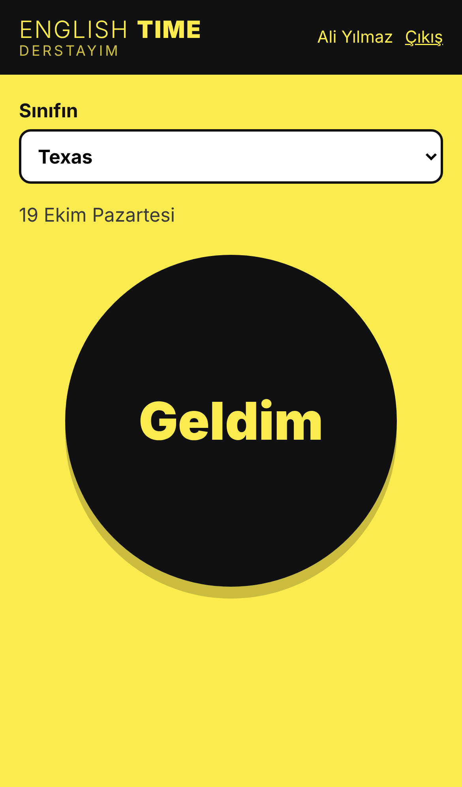
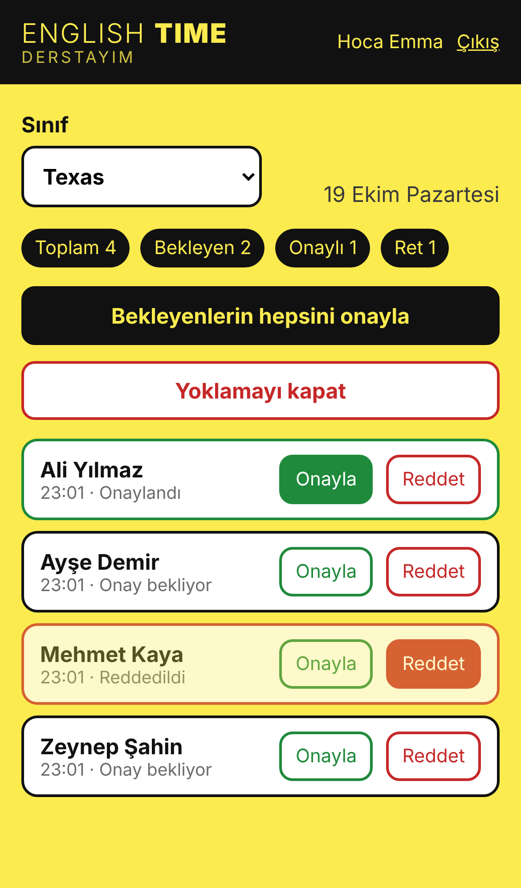
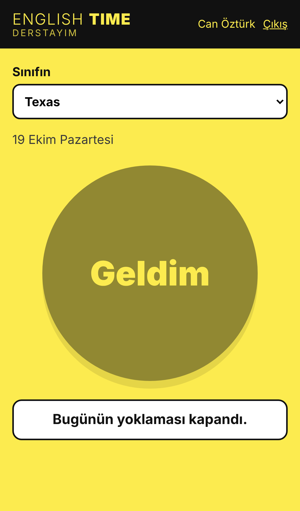

# 🟡 Derstayım

**Ders + Stay (kalmak).**

İngilizcede *stay*, “kalmak” veya “bulunmak” anlamına gelir. Derstayım, Türkçedeki “Dersteyim” ifadesinden ilham alan bir kelime oyunudur.

## 📚 Proje Hakkında

Kurslarda yoklamanın unutulması veya sonradan doldurulması, öğrencilerin derse gerçekten katılıp katılmadığını belirsiz hâle getirebilir.

**Derstayım**, bu sorunu basit bir dijital yoklama sistemiyle çözmeyi hedefler. Öğrenciler kendi telefonlarından yoklama verir, öğretmen ise katılım kayıtlarını canlı olarak görüntüler ve tek dokunuşla onaylar veya reddeder.

Daha az uğraş, daha güvenilir yoklama. 🎯

## ✨ Temel Özellikler

- 📱 Tek dokunuşla yoklama
- 🔐 Google ile giriş
- 🕒 Sunucu saatine göre kayıt
- ✅ Öğretmen onayı ve canlı liste
- 🔒 Yetkiye dayalı güvenli kayıt sistemi

## 📸 Ekranlar

| Öğrenci | Hoca | Yoklama kapalı |
|---|---|---|
|  |  |  |

## ⚙️ Nasıl Çalışır

1. Öğrenci siteye Google hesabıyla girer, sınıfını (Amerika eyaletleri: Texas, California…) seçer.
2. **Geldim**'e basar; giriş saati sunucu saatiyle kaydedilir.
3. Hoca kendi telefonunda listeyi canlı görür: **Onayla / Reddet** ya da **Bekleyenlerin hepsini onayla**.
4. Hoca **Yoklamayı kapat** deyince o gün o sınıfa kimse giriş yapamaz.

Teknoloji: düz HTML/CSS/JS + Firebase (Authentication, Firestore, Hosting). Sunucu kurulumu yok, ücretsiz kotada çalışır.

## 🔒 Kurallar (`firestore.rules`)

| Kural | Nasıl sağlanıyor |
|---|---|
| Sadece kendi adına | Kayıttaki `uid` ve isim Google girişiyle aynı olmak zorunda |
| Sadece bugün | Tarih sunucu saatinden (Türkiye, UTC+3) hesaplanır |
| Saat değiştirilemez | `checkedInAt` sunucu saatine eşit olmak zorunda |
| Kendi kaydını değiştiremez/silemez | Güncelleme sadece hocada, silme kimsede yok |
| Onay/ret sadece hocada | `teachers` koleksiyonunda olan kişi |
| Yoklama kapanınca giriş yok | `sessions/{tarih_sınıf}.open == false` ise reddedilir |
| Günde bir giriş | Belge kimliği `tarih_sınıf_uid` |

Kurallar Google sunucusunda çalışır; tarayıcıyı kurcalamak işe yaramaz.

## 🗂️ Proje Yapısı

```
public/            Uygulama (index.html, app.js, style.css, config.js)
firestore.rules    Güvenlik kuralları
test/              Kural testleri (Firebase emülatörü ile)
docs/              Ekran görüntüleri
```

## 🛠️ Geliştirme

```
npm install
npm test        # 19 kural testi (Java gerekir)
npm run dev     # http://localhost:5000 – emülatörle yerel deneme
```

## 🚀 Yayına Alma (bir kerelik, ~15 dk)

1. https://console.firebase.google.com → **Proje oluştur**.
2. **Authentication → Sign-in method → Google**'ı açın.
3. **Firestore Database → Veritabanı oluştur** (bölge: `eur3`).
4. **Proje ayarları → Web uygulaması ekle** → değerleri `public/config.js`'e yapıştırın. Sınıf listesi de oradadır.
5. `npx firebase login` → `npm run deploy` (proje `.firebaserc`'de tanımlı: `dersstayim`)
   Adres: `https://PROJE-ID.web.app` (QR kod yapıp sınıf kapısına asın).
6. **Hocayı tanımlayın:** Hoca siteye bir kez girsin. Konsolda **Authentication → Users**'tan UID'sini kopyalayın; **Firestore**'da `teachers` koleksiyonuna bu UID ile bir belge ekleyin (alan: `name`). Sayfa yenilenince hoca ekranı açılır.

🚧 **Proje geliştirme aşamasındadır.**

**Derstayım — Geldim, kaydoldum, dersteyim!** 🟡
